# Screenshots, spec 0015

What this spec looked like when it was finished (made by `pnpm --filter @brunchsters/web shots:spec 0015`, from the list in `screenshots.json`). A record of a moment, not a baseline: nothing compares against these.

## The inbox: host activity grouped, member notices, each row a link to its brunch

`notifications/inbox`

| phone-light                                                                                                                            | phone-dark                                                                                                                           |
| -------------------------------------------------------------------------------------------------------------------------------------- | ------------------------------------------------------------------------------------------------------------------------------------ |
| 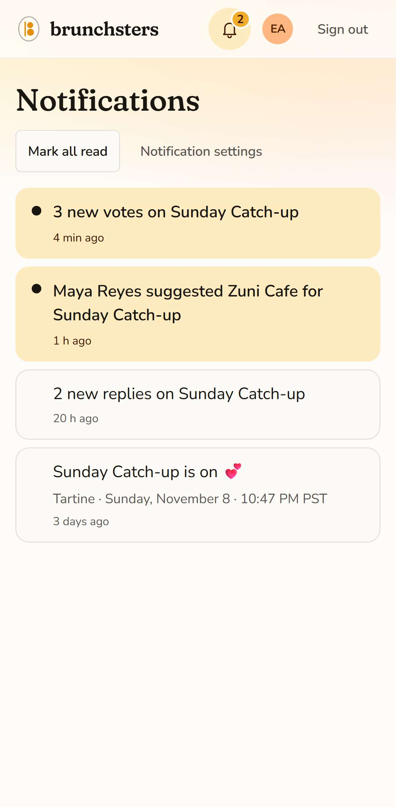 | 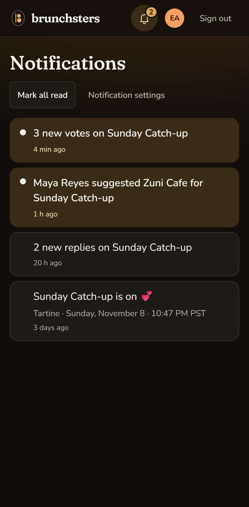 |

## Nothing yet, with a verb out

`notifications/inbox-empty`

| phone-light                                                                               |
| ----------------------------------------------------------------------------------------- |
| 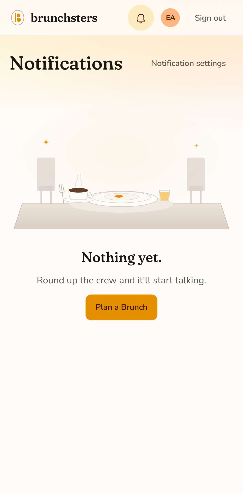 |

## The bell in the top bar with an unread count

`notifications/bell`

| phone-light                                                                                        | desktop-light                                                                                          |
| -------------------------------------------------------------------------------------------------- | ------------------------------------------------------------------------------------------------------ |
| 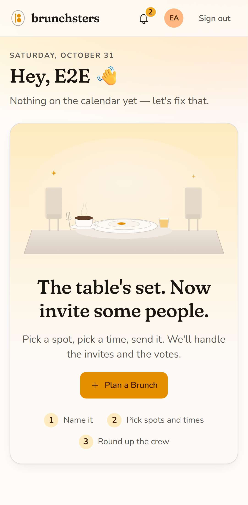 | 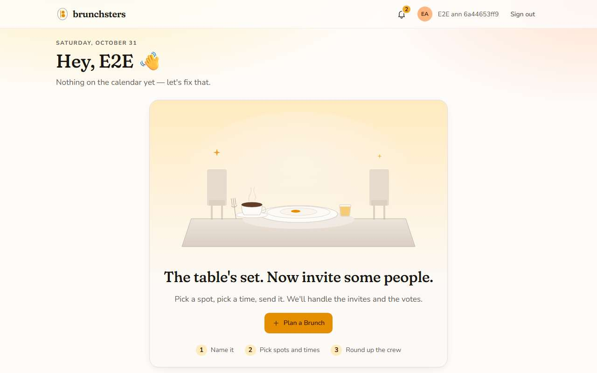 |

## Preferences grouped in words, only the things that really happen

`notifications/settings`

| phone-light                                                                                                                | phone-dark                                                                                                               |
| -------------------------------------------------------------------------------------------------------------------------- | ------------------------------------------------------------------------------------------------------------------------ |
| 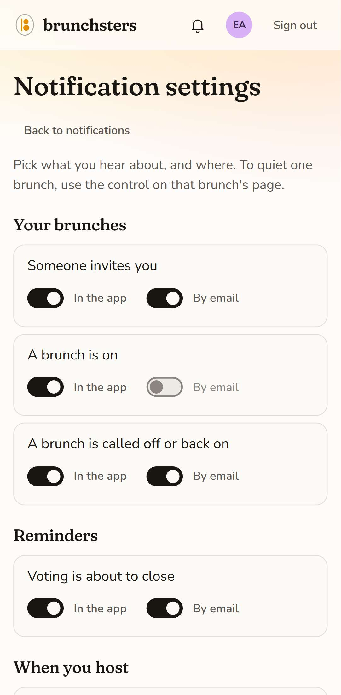 | 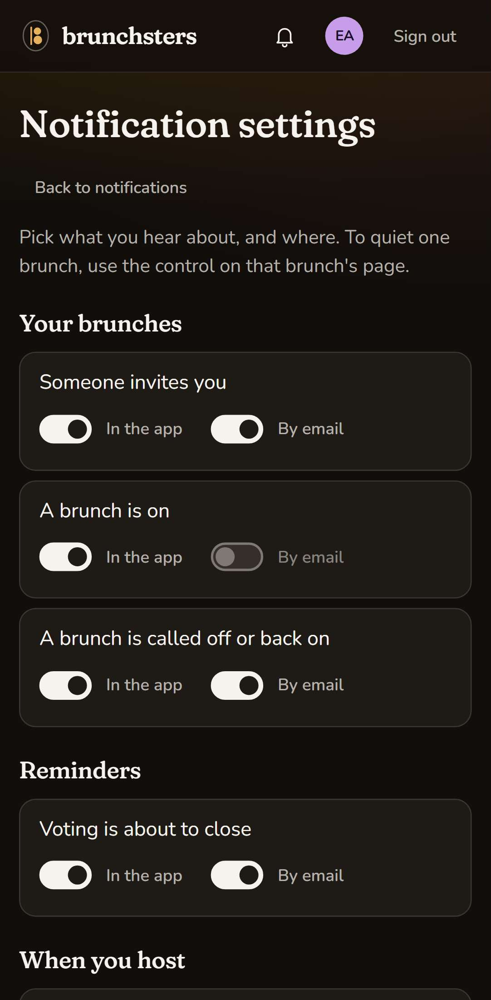 |

## Mute a brunch from its page: all, just big stuff, or muted

`notifications/mute`

| phone-light                                                                                                      |
| ---------------------------------------------------------------------------------------------------------------- |
| 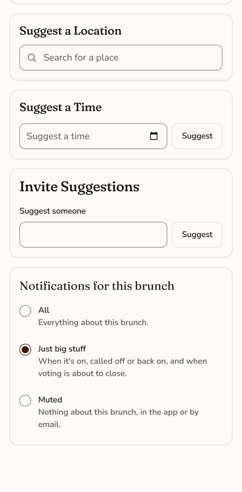 |

## An invite that did not go out says so on its line, with Resend beside it

`notifications/invite-failed`

| phone-light                                                                                                                             | desktop-light                                                                                                                               |
| --------------------------------------------------------------------------------------------------------------------------------------- | ------------------------------------------------------------------------------------------------------------------------------------------- |
| 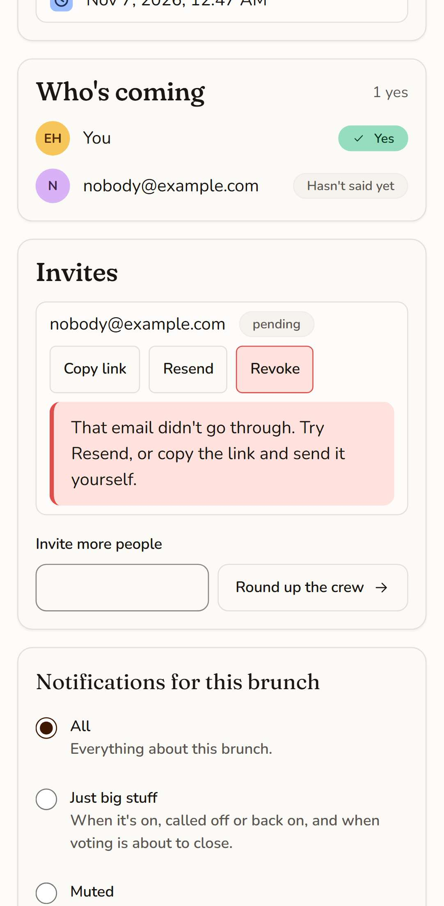 | 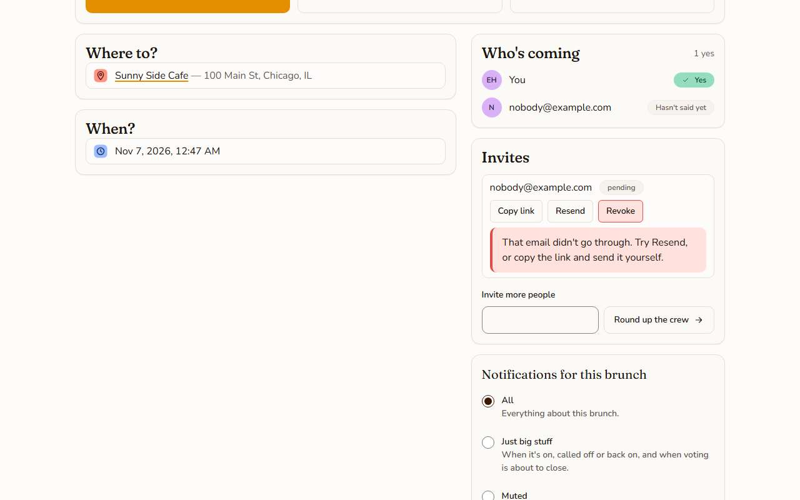 |

## A brunch that is over: read-only, labelled, no bring-back

`notifications/over`

| phone-light                                                                                                     |
| --------------------------------------------------------------------------------------------------------------- |
| 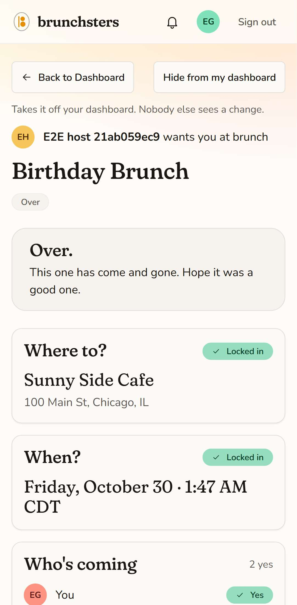 |
